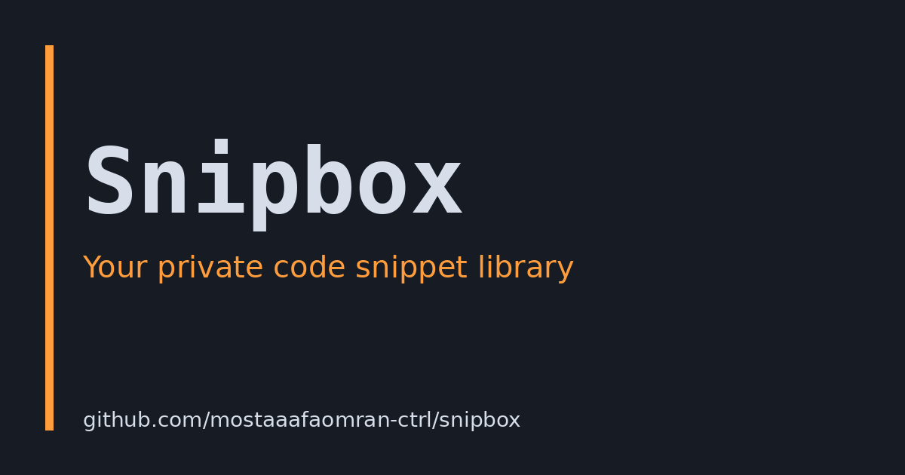

# Snipbox

Your private code snippet library.

 

**Live demo:** https://mostaaafaomran-ctrl.github.io/snipbox/ (add `?demo=1` to see it filled with sample data)

Save, tag, search and copy code snippets. Everything stays in your browser. Export and import JSON.

## Features

- Title, language, tags and code per snippet
- Instant search and tag filters
- Copy, duplicate, delete, tab key works in the editor
- Export and import as JSON
- No account, no server

## Run it locally

It is one `index.html` file. Open it in a browser. No build step, no dependencies, no server.

## Privacy

Everything runs in your browser. Nothing is uploaded. Data you enter is kept in your browser's local storage on your device only.

## بالعربي

مكتبة سنيبتس خاصة بيك: احفظ الكود، حط تاجز، ابحث وانسخ. كل حاجة بتتحفظ في المتصفح بس.

افتح الملف `index.html` في المتصفح وهيشتغل على طول، من غير تسجيل ومن غير سيرفر.

## License

MIT
